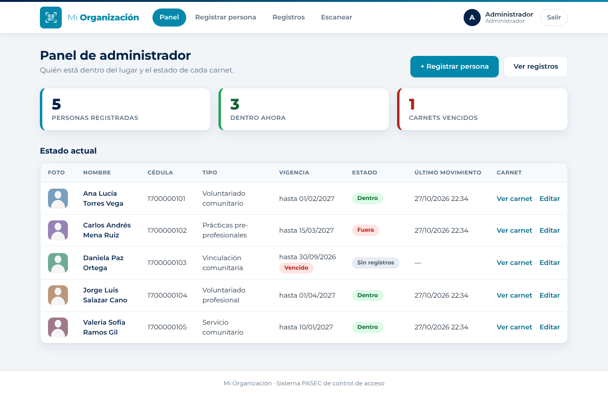
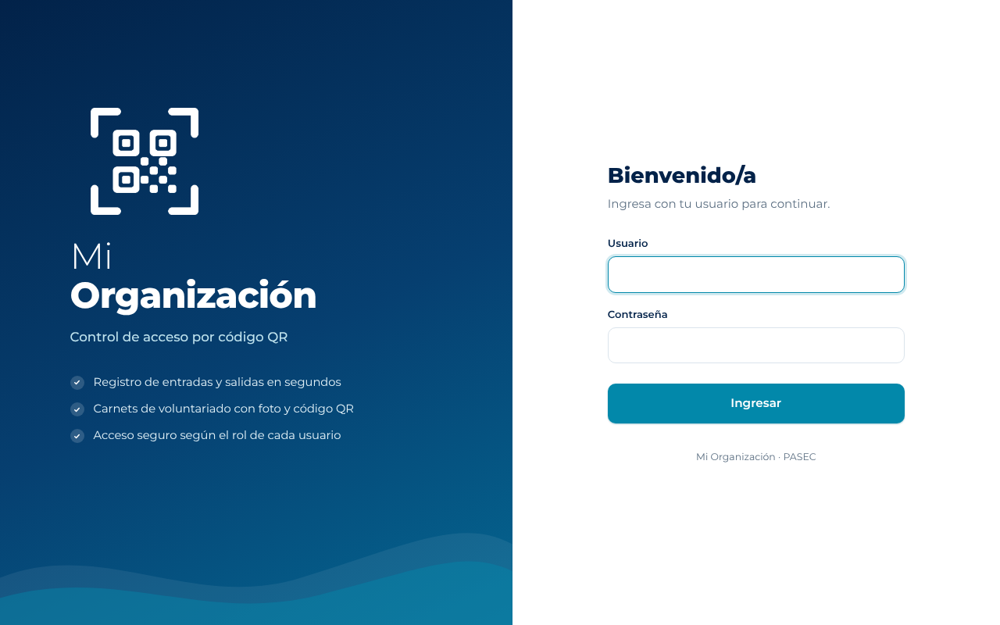
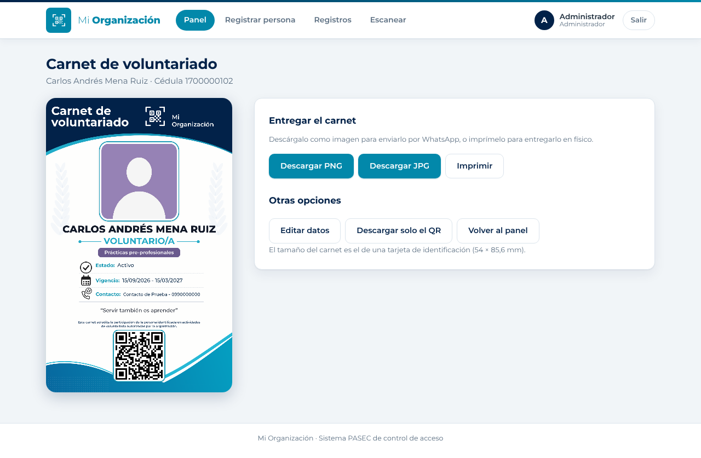
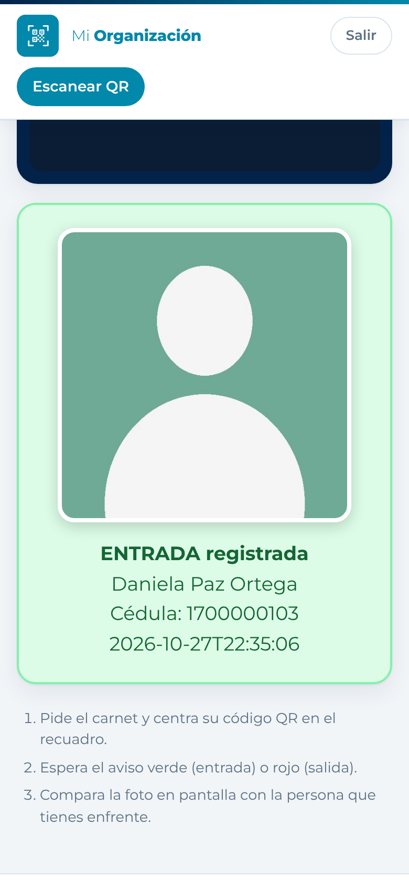
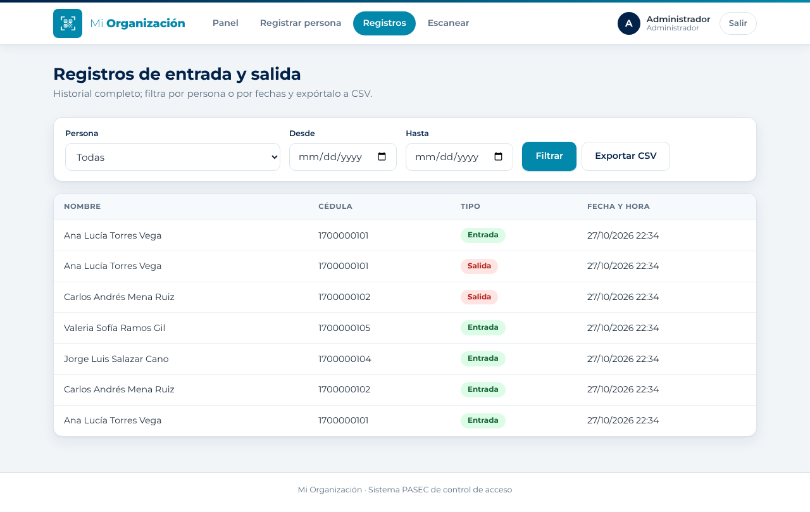

# PASEC · Control de acceso con códigos QR

Aplicación web en **Python y Flask** que registra la entrada y salida de personas escaneando un código QR desde el celular de un guardia. Genera carnets de voluntariado con foto y QR, separa los permisos de administrador y de guardia, y está pensada para funcionar con datos móviles desde cualquier red.

Es un proyecto real: lo diseñé y desarrollé para una organización de voluntariado en Quito, donde se usa para controlar el ingreso de su personal. Esta versión pública usa un nombre y un logo genéricos y datos de prueba.



## Qué hace

- **Registro con un escaneo.** El guardia apunta la cámara de su celular al carnet y el sistema decide solo si es una entrada o una salida, según el último movimiento de esa persona.
- **Verificación con foto.** Al escanear, la foto de la persona aparece en grande para que el guardia confirme que coincide con quien tiene enfrente.
- **Carnets de voluntariado.** El administrador llena los datos y ve en vivo cómo queda el carnet (foto, tipo de voluntariado, vigencia, contacto de emergencia y QR). Se descarga en PNG o JPG para enviarlo por WhatsApp o imprimirlo.
- **Roles separados.** El guardia solo ve la pantalla de escaneo; el panel, los registros y los datos personales quedan para el administrador.
- **Panel e historial.** Quién está dentro ahora, carnets vencidos, historial filtrable por persona y fecha, y exportación a CSV.
- **Funciona sin internet para el visitante.** El QR va impreso o en una imagen; solo el celular del guardia necesita conexión.

| Ingreso | Carnet generado |
|---|---|
|  |  |

| Escaneo desde el celular del guardia | Historial de movimientos |
|---|---|
|  |  |

## Tecnologías

| Parte | Herramientas |
|---|---|
| Backend | Python 3, Flask, Werkzeug (contraseñas con hash), Waitress (servidor de producción) |
| Base de datos | SQLite, con migración automática de columnas al actualizar |
| Frontend | HTML con plantillas Jinja2, CSS propio, JavaScript sin frameworks |
| QR | `qrcode` y Pillow para generarlos; `html5-qrcode` para leerlos con la cámara |
| Carnet | Dibujado en `<canvas>` a doble resolución (1276 × 2020 px), listo para imprimir |
| Despliegue | PythonAnywhere (HTTPS automático) o una PC con Windows y Cloudflare Tunnel |

## Decisiones de diseño

- **El QR no contiene la cédula.** Contiene un código aleatorio (token) que el sistema relaciona con la persona. Así nadie puede fabricar un QR válido solo con conocer la cédula de otra persona.
- **Privacidad de las fotos.** Se aceptan PNG o JPG de hasta 8 MB, se guardan como JPG de máximo 1200 px y se les quitan los metadatos, como la ubicación GPS del celular.
- **Validación en el servidor.** La cédula solo admite caracteres seguros, lo que evita nombres de archivo con rutas peligrosas. Las fechas, teléfonos y archivos de imagen también se validan antes de guardar.
- **Sin dependencias externas en el escaneo.** La librería de lectura de QR va incluida en el proyecto, así que la pantalla del guardia no depende de un CDN.
- **Arquitectura simple a propósito.** Una sola aplicación Flask y un archivo SQLite: fácil de respaldar, mover y mantener para una organización pequeña sin personal técnico.

## Cómo probarlo

Requisitos: Python 3.9 o superior.

```bash
git clone https://github.com/arielitooo10/Pasec-.git pasec
cd pasec
python3 -m venv venv
source venv/bin/activate          # En Windows: venv\Scripts\activate
pip install -r requirements.txt
python init_db.py                 # crea la base de datos y los usuarios de prueba
python app.py                     # abre http://localhost:5000
```

Usuarios de prueba que crea `init_db.py`:

| Usuario | Contraseña | Rol |
|---|---|---|
| `admin` | `admin123` | Administrador |
| `guardia` | `guardia123` | Guardia (solo escaneo) |

> Son solo para probar en tu computadora. Antes de usarlo en serio, cámbialas con `python cambiar_clave.py` y define la variable de entorno `SECRET_KEY`.

La cámara del navegador solo funciona en `localhost` o con HTTPS. Para que el guardia escanee desde su propio celular, despliégalo en un servidor con HTTPS.

## Pruebas automáticas

```bash
python test_flujo.py     # login, registro de persona, escaneos de entrada y salida, permisos por rol
python test_carnet.py    # carnet, validaciones, migración de la base de datos y archivos estáticos
```

`test_carnet.py` usa una base de datos temporal. `test_flujo.py` crea una persona de prueba en `pasec.db`; para empezar limpio, borra `pasec.db` y vuelve a correr `python init_db.py`.

## Personalizarlo

- **Nombre y textos:** `config.py` (nombre de la organización, subtítulo y textos fijos del carnet).
- **Logo:** reemplaza `static/img/emblema_blanco.png` (blanco con fondo transparente) conservando el nombre, junto con `favicon.ico`, `icono-180.png` e `icono-512.png`.
- **Colores:** variables al inicio de `static/css/style.css` (`--teal`, `--marino`, ...).
- **Diseño del carnet:** `static/js/carnet.js`.

## Despliegue

- **En internet (PythonAnywhere u otro hosting con HTTPS).** Es la opción más simple: el guardia escanea desde cualquier red y el HTTPS ya viene incluido.
- **En una computadora propia con Windows.** `GUIA_INSTALACION_WINDOWS.md` explica la instalación paso a paso con los scripts `.bat`: arranque automático, una copia de seguridad cada vez que arranca (`respaldo.py`), cambio de contraseña y publicación con dominio propio y HTTPS mediante Cloudflare Tunnel.

## Estructura

```
├── app.py                  Rutas Flask: login, panel, registro de personas, carnet, escaneo y API
├── models.py               Acceso a SQLite y lógica de entradas, salidas y estado del carnet
├── config.py               Nombre de la organización y textos del carnet
├── init_db.py              Crea la base de datos y los usuarios iniciales
├── cambiar_clave.py        Cambia la contraseña de un usuario
├── respaldo.py             Copia de seguridad de la base de datos y las fotos
├── servidor.py             Servidor de producción con Waitress
├── test_flujo.py           Prueba del flujo completo
├── test_carnet.py          Prueba del carnet y las validaciones
├── templates/              Páginas HTML (Jinja2)
├── static/
│   ├── css/style.css
│   ├── fonts/              Montserrat (licencia OFL)
│   ├── img/                Emblema, favicon e íconos
│   └── js/                 Escaneo, editor y dibujo del carnet, lector de QR
├── docs/capturas/          Imágenes de este README (datos ficticios)
└── *.bat                   Instalación y uso en Windows
```

## Próximas mejoras

- Rechazar al escanear los carnets vencidos o que aún no están vigentes.
- Crear y administrar usuarios guardias desde la web.
- Reportes de horas dentro del lugar y salida automática al cierre del día.
- Generar carnets de varias personas a la vez en un PDF para imprimir.

## Autor

**Ariel Guañuna**, estudiante de Ingeniería en Ciencias de la Computación en la Universidad San Francisco de Quito.

[LinkedIn](https://www.linkedin.com/in/ariel-alejandro-gua%C3%B1una-lincango-73761231a/)

Las capturas usan personas y datos ficticios. La tipografía Montserrat se distribuye con licencia SIL OFL y `html5-qrcode` con licencia Apache 2.0.
